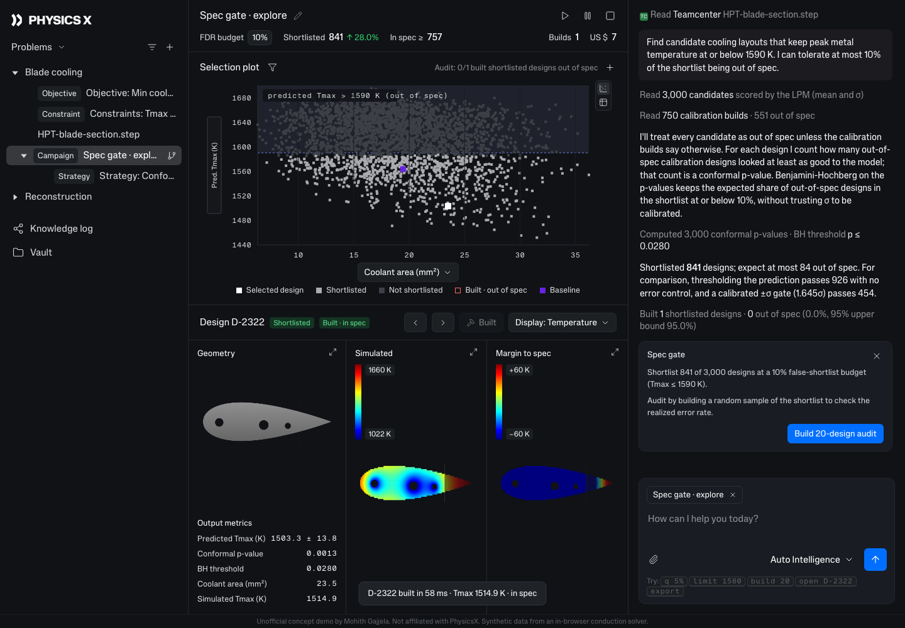

# Spec Gate · shortlist AI-predicted designs with a guaranteed error rate

**Live demo:** https://mohith26.github.io/physicsx-spec-gate/ · unofficial concept by Mohith Gajjela, not affiliated with PhysicsX.

Physics AI lets a team score thousands of candidate designs in seconds, but the decision that matters is binary: *which predicted-in-spec designs can I trust without running the full simulation?* Thresholding the prediction lets out-of-spec designs through at an unknown rate, and a calibrated ±σ gate picks an arbitrary operating point (calibrated coverage is a *marginal* property; it says nothing about the share of failures among the designs you select). **Spec Gate** answers the decision question directly: you choose a false-shortlist budget *q*, and it returns a shortlist whose expected share of out-of-spec designs is **guaranteed to be at most q**, for any model and any σ, using conformal selection (conformal p-values + Benjamini-Hochberg). It lives as a campaign in the PhysicsX platform shell, with a selection plot, per-design drill-down, an in-browser solver for "builds", an audit action and an agent panel.



## Results (`data/results.json`, reproduced by the tests)

Problem: cooling layout for an HPT blade section (3 cooling holes, 9 design variables), spec Tmax ≤ 1590 K (about 30% of the design space meets it). A GP surrogate (stand-in for an LPM) is trained on 250 simulations; 750 simulations are held out for calibration; 3,000 candidates are scored by the surrogate only. Ground truth for every candidate comes from the finite-volume solver and is used **only for evaluation**. Means over 300 random calibration/candidate splits:

| Rule | False-shortlist rate (FDR) | Guaranteed? | In-spec designs recovered (power) |
|---|---|---|---|
| Threshold the prediction (μ ≤ 1590 K) | 14.2% | no | 88% |
| Calibrated σ gate (μ + 1.645σ ≤ 1590 K, σ scaled to 95% coverage) | 1.1% | no | 46% |
| **Spec Gate, q = 10%** | **9.7%** | **≤ 10%** | **79%** |
| Spec Gate, q = 5% | 4.7% | ≤ 5% | 63% |
| Spec Gate, q = 2% | 1.7% | ≤ 2% | 46% |

Read it this way: the σ gate happens to be safe here but throws away more than half of the good designs, and you cannot dial it; the naive threshold looks efficient but lets 14% failures through with no warning. Spec Gate puts the operating point where you ask for it and proves it stays there. At an equal error rate (q = 2%) it selects essentially the same designs as the σ gate, which is expected: both rank by (limit − μ)/σ; the difference is that Spec Gate *derives the threshold from data with a guarantee* instead of picking 1.645σ.

Default split, q = 10%: 841 of 3,000 shortlisted, 94 out of spec (11.2% realized FDP; FDR is a guarantee on the average, and individual splits scatter around it), 83% of in-spec designs found.

## How it works

1. **Score.** For each design, s(x) = (limit − μ(x)) / σ(x) from the model. Any model works (LPM, ensemble, MC-dropout); σ does not need to be calibrated.
2. **Conformal p-value.** For candidate j, p_j = (1 + #{out-of-spec calibration designs with score ≥ s_j}) / (n + 1). In words: how many designs that the model liked at least as much turned out to fail.
3. **Benjamini-Hochberg** at level q over the 3,000 p-values. Under exchangeability of calibration and candidate designs (same sampler), FDR ≤ q (Jin & Candès, *Selection by prediction with conformal p-values*, JMLR 2023).
4. **Audit.** "Build 20-design audit" runs the real solver on a random sample of the shortlist and reports the realized failure share with a Clopper-Pearson bound.

**Solver ("build").** 2-D steady conduction in a NACA 0030-like blade section (50 mm chord, k = 20 W/mK), hot gas outside (1,700 K, h peaking at the leading edge), coolant in the holes (850 K, h = 9,000 W/m²K), finite volumes on a 120 × 40 grid with Robin boundaries, solved with Jacobi-preconditioned CG (≈ 5 ms in the browser). Peak metal temperature is taken over the first 75% of chord (the trailing edge has separate ejection cooling in real blades).

## The app

- **Campaign "Spec gate · explore"** under the problem *Blade cooling*, in the platform's sidebar tree with Objective, Constraint, geometry, Campaign and Strategy rows.
- **Header metrics**: FDR budget (click to change), shortlisted count, guaranteed in-spec lower bound, Builds and US$ (illustrative per-build cost).
- **Selection plot**: 3,000 candidates, predicted Tmax vs coolant area (or vs σ), out-of-spec band, shortlisted vs not, built designs marked pass/fail, baseline design. Table toggle lists the top shortlisted designs by p-value.
- **Design panel**: geometry, simulated temperature field and margin-to-spec (after Build), output metrics including the p-value and BH threshold.
- **Agent panel**: the gate's reasoning and numbers, computed live; composer accepts `q 5%`, `limit 1580`, `build 20`, `open D-2322`, `export`.
- Deep links (`#/campaign?d=1322&q=0.05&L=1580`), localStorage state, keyboard shortcuts (`?`), Knowledge log (all builds) and Vault views, CSV/JSON export, loading/empty/error states, 1280 px and up.

## Tests and reproducibility

```bash
node scripts/seed.mjs       # ~40 s: 4,000 solver runs + GP fit -> data/designs.json
node scripts/results.mjs    # ~1 s: data/results.json
node --test test/*.test.mjs
python3 -m http.server      # open http://localhost:8000
```

13 tests: feasibility and canonical ordering of sampled designs; the solver's maximum principle and PCG convergence; exact affine shift invariance; a property test that stronger cooling never raises peak temperature; stored ground truth matching the solver; GP interpolation and distance-dependent σ; σ-scaling coverage; a hand-worked Benjamini-Hochberg example; a randomized validity test for conformal p-values; a randomized FDR-control test on synthetic surrogate data; nested shortlists across q; the evaluation counts; and the headline numbers reproducing from the committed data. CI runs them on every push.

## Prior art and what is new

- PhysicsX's models ship UQ: Monte Carlo dropout with σ scaling from post-training calibration and ±2σ intervals ([Scaling physics AI for automotive aerodynamics](https://www.physicsx.ai/newsroom/scaling-physics-ai-for-automotive-aerodynamics), [Uncertainty quantification](https://www.physicsx.ai/newsroom/uncertainty-quantification)), plus active learning and "evaluation gates and human review" on the platform page. I found no FDR-controlled selection or conformal guarantee in their public material.
- Conformal selection is from Jin & Candès (JMLR 2023), used for drug-candidate screening and LLM output filtering; conformal prediction for surrogate models and neural operators is an active research topic. The new part is the product decision: a campaign-level spec gate with a user-set error budget, an audit loop through builds, and the result shown where engineers make the call.

## Limitations

- The guarantee needs calibration designs drawn like the candidates. Candidates proposed by an optimizer (not a sampler) are a covariate shift; weighted conformal selection (Jin & Candès 2023b) handles known shifts and is the natural next step.
- FDR bounds the average share of failures; any single shortlist can be above q (the default split is 11.2% at q = 10%).
- Synthetic problem: 2-D conduction, not CFD/conjugate heat transfer; the GP is a stand-in for an LPM; costs per build are illustrative.
- UI rebuilt from two public 2026 platform screenshots (physicsx.ai home and platform pages); fonts are PhysicsX's web fonts loaded from their CDN; details of the logged-in app may differ.

Unofficial concept demo by Mohith Gajjela. Not affiliated with PhysicsX. Synthetic data.
